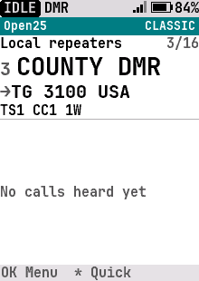
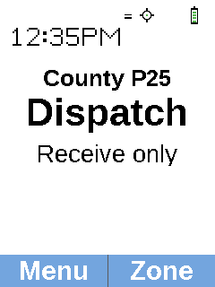
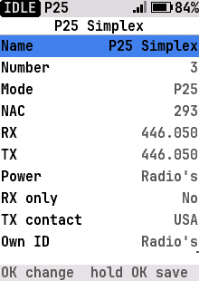
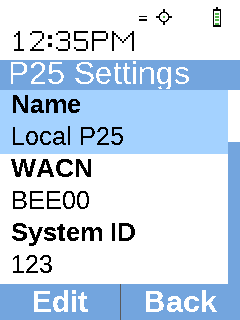

<!-- SPDX-License-Identifier: MIT -->
<!-- Copyright (c) 2026 Open25-DM32 Contributors -->

# Open25-DM32

**Experimental firmware for the Baofeng DM-32UV, with two editions: Classic and Next.**

Open25-DM32 brings P25 to the DM-32, with programming from the radio's front
panel and browser tools for installation, programming, backup and recovery.
Both current builds include analog FM, DMR, conventional P25 and NXDN 4800/9600.
Classic keeps the RadioFoundry interface. Next adds a different interface and
P25 Phase 1 trunking.

**[Open the tools](https://kd8zmm.com/open25-dm32/)** ·
**[Classic CPS](https://kd8zmm.com/open25-dm32/classic-cps/)** ·
**[Next CPS](https://kd8zmm.com/open25-dm32/cps/)** ·
**[Flasher v3](https://kd8zmm.com/open25-dm32/v3/firmware.html)**

Report firmware and P25 problems to **[Open25-DM32 issues](https://github.com/tylerwatt12/Open25-DM32/issues)**.

## Choose your edition

| Open25-DM32 Classic | Open25-DM32 Next |
| :---: | :---: |
|  |  |
| RadioFoundry interface with an Open25 / CLASSIC Home band | New interface with clock and a banner-free Home screen |
|  |  |
| Conventional P25: NAC, contact target and radio ID | Trunked P25: systems, sites, WACN and System ID |
| **[0.1.0-rc1-r14 release candidate available](https://github.com/tylerwatt12/Open25-DM32/releases/tag/classic-0.1.0-rc1-r14)** | **Private development build · not publicly released** |

These screen examples use synthetic programming and the current native
renderers. Next is shown in light mode with its new glyphs. Both editions have
the Open25 signal-ring boot emblem. Classic keeps
its Home identity band; Next's Home banner has been removed. Both have light
and dark themes.

| Feature | Classic r14 | Next development build |
| --- | --- | --- |
| Analog FM | ✅ | ✅ |
| Conventional DMR | ✅ | ✅ |
| Conventional P25 Phase 1 | ✅ | ✅ |
| NXDN 4800 / 9600 | ✅ | ✅ |
| Trunked P25 Phase 1 | ❌ | ✅ |
| P25 encryption | ❌ | ✅ AES-256, DES-OFB, ADP/RC4 |
| Programming | Front panel · matched Classic CPS | Front panel · matching Next CPS development tools |
| Extended RX included by default | ✅ | ✅ |
| Source in this repository | ✅ | ❌ Private |

FPP means programming from the radio's front panel. Classic r14 uses contacts
for P25 group, private and all-call destinations, with separate receive and
transmit NACs. Its matched CPS also edits FM, DMR and NXDN. The CPS retains a
separate Classic r9–r13 profile for earlier files and browser drafts; changing
the profile does not convert those files to r14.

Next adds P25 trunked systems and sites, scan lists, receive-only control-channel
monitoring, site discovery, caller aliases, recent calls and P25 encryption.
Its programming tools must match the development firmware. Encryption and
interoperability testing are ongoing.

**P25 Phase 2 and LSM are not supported.** Extended 700/800 MHz ranges are
available for receive-only tuning, but reception throughout those ranges is
not hardware-qualified. A listed feature does not establish compatibility with
every radio, system or hardware revision.

## Release status

**Classic and Next remain experimental firmware.** Classic
**0.1.0-rc1-r14** is available in
[Flasher v3](https://kd8zmm.com/open25-dm32/v3/firmware.html), under
**Open25-DM32 Classic → Standard · DM-32UV**. Next remains in private development;
there is no public Next firmware package or announced release date.

Classic r14 refreshes the upstream radio interface and conventional protocol
implementations, retains the necessary audio and state-handling repairs, adds
NXDN, and includes the Open25 boot emblem and Home identity band. Extended RX
is always enabled, and the transmit policy is described below.

The r14 upgrade changes P25 programming from the earlier direct-talkgroup
extension to native contact links. The updated flasher performs the one-time
conversion and saves a verified recovery file before writing. Use the matched
Classic CPS after upgrading.

Earlier revisions addressed P25 transmit startup and cleanup (r13), speaker
playback servicing (r12), P25 detection in Classic CPS (r11), and RFKV-based
programming (r9). See the [release history](https://github.com/tylerwatt12/Open25-DM32/releases)
for their original notes and qualification limits.

**Known limits:** Classic P25 transmit audio can be quieter than Next. NXDN
recovery after damaged traffic, intermittent startup/cable behavior and long-term
traffic handling remain under investigation. The earlier PL/CTCSS issue while sending
DTMF has not been established as resolved. Host tests and bounded radio checks
do not establish full endurance, physical power-cut recovery or compatibility
with every DM-32UV revision.

## Installing or upgrading Classic

1. Open [Flasher v3](https://kd8zmm.com/open25-dm32/v3/firmware.html) in desktop Chrome or Edge and select Classic.
2. Connect the radio, select the release candidate, and read the proposed operation.
3. Save and keep a verified full-radio backup before installing. If a programming conversion is required, also save and retain the flasher's verified recovery ZIP.
4. Install the selected package and check that the radio starts normally.
5. Open the matched [Classic CPS](https://kd8zmm.com/open25-dm32/classic-cps/) and **Read from Radio** before editing.

The exact public r13 build has a supported migration to r14. The flasher checks
the source firmware and programming, shows the conversion plan, and requires a
saved and verified recovery ZIP before any write. Unsupported records, unknown
source firmware or insufficient space stop the upgrade. The radio itself does
not perform the r13 conversion.

**Do not write an old r13 BIN or draft over migrated r14 programming.** Keep the
recovery file if you need to restore the earlier application and affected
programming to the same physical radio. A migration recovery ZIP covers the
upgrade's affected data; it is not a substitute for a full-radio backup.

Older or OEM firmware is not a qualified direct r14 migration source. The
[previous r13 application package](https://kd8zmm.com/open25-dm32/releases/classic/standard/Open25-DM32-Classic-0.1.0-rc1-r13-p25-tx-cleanup-application.zip)
remains available through Flasher v3's local-file workflow as an intermediate
for compatible installations. Check its compatibility first and establish
supported r13 programming before selecting r14; unsupported older codeplugs
are not converted. Retired pre-RFKV programming must be recreated in the
appropriate CPS.

The r14 package contains no proprietary codec. It uses the radio's existing
compatible codec and preserves the bootloader and calibration. Codec preparation,
full-radio backup/restore and factory recovery are separate flasher operations.
Use only a backup belonging to that same radio.

## Programming and firmware tools

- **[Classic CPS](https://kd8zmm.com/open25-dm32/classic-cps/):** program Classic's FM, DMR, conventional P25 and NXDN channels; save BIN/CSV files; select the native r14 or legacy r9–r13 profile.
- **[Next CPS](https://kd8zmm.com/open25-dm32/cps/):** separate tools for Next development. Use a version matched to the firmware being tested.
- **[Flasher v3](https://kd8zmm.com/open25-dm32/v3/firmware.html):** install or update supported firmware, make full-radio backups, restore a backup, or prepare a factory update file.

The [tools homepage](https://kd8zmm.com/open25-dm32/) links these tools. Retired
Flasher v1/v2 public entry URLs redirect to Flasher v3.

For P25, **Same as RX** inherits the receive NAC, using `293` when RX is wildcard
`F7E`. An explicit TX NAC, including `000` or a value equal to RX, remains fixed
when RX changes. TX NAC `F7E` and `F7F` cannot be sent.

## Frequency policy

Extended RX is included by default in both current builds. FM, DMR and NXDN TX
is allowed within **136–174 MHz** and **400–480 MHz**. P25 TX is limited to:

- **144 ≤ MHz < 148** and **420 ≤ MHz < 450**.
- **151.820–151.940 MHz** and **154.570–154.600 MHz**.
- **462.550–462.725 MHz** and **467.550–467.725 MHz**.

The service exceptions are continuous ranges: endpoints and frequencies between
channel centers are included. Extended receive ranges remain receive-only.
Saved RX-only choices and normal transmit-admission checks remain active.
These firmware limits do not grant permission to transmit.

> [!WARNING]
> **THERE IS NO EASY WAY TO RESTORE THE RADIO WITHOUT A BACKUP.**
>
> **Keep a verified full-radio backup before installing firmware.**
> A CPS codeplug file is **not** a full firmware backup.
>
> **Use only DM-32 handheld hardware. Other models have not been validated.**
>
> **I am not responsible for bricked radios.**

Full backups can contain identifiers, keys and factory calibration. Store them
privately and restore only a backup belonging to that same radio.

## Usage disclaimer

This firmware is for amateur radio, authorized P25 communications and technical
research. Trunked monitoring is receive-only by default. The project does not
provide assistance with unauthorized system access, subscriber impersonation,
or bypassing system access controls.

**On trunked systems, registration and affiliation transmit even without pressing
PTT.** Only transmit on frequencies and systems you are authorized to use;
registration and affiliation require the system operator's permission.
Interference with public-safety communications can disrupt emergency response
and cause loss of life.

## Credits and license

Open25-DM32 builds on [RadioFoundry](https://github.com/RadioFoundry/RadioFoundry)
and other open-source projects. Classic's firmware is based on MIT-licensed
RadioFoundry; its native IMBE implementation retains the applicable ISC mbelib
notice. Other dependencies keep their original licenses and attributions. See
[LICENSE](LICENSE), [LICENSES](LICENSES), [notices](notices) and
[FORKING.md](FORKING.md).

This repository contains **Classic source only**. Next source remains private.
Firmware packages are hosted on kd8zmm.com; GitHub contains source only.
See **[BUILD.md](BUILD.md)** for Classic's pinned upstream source, dependencies,
compiler requirements, build commands and reproducibility checks.

## Support development

Donations help cover development and testing expenses.

[GitHub Sponsors](https://github.com/sponsors/tylerwatt12?metadata_project=open25-dm32) ·
[Ko-fi](https://ko-fi.com/kd8zmm)

Report problems through [GitHub Issues](https://github.com/tylerwatt12/Open25-DM32/issues).
Include your edition, build, radio model and steps to reproduce the problem.
Keep backups, keys, calibration, private identifiers and private traffic out
of public reports.
