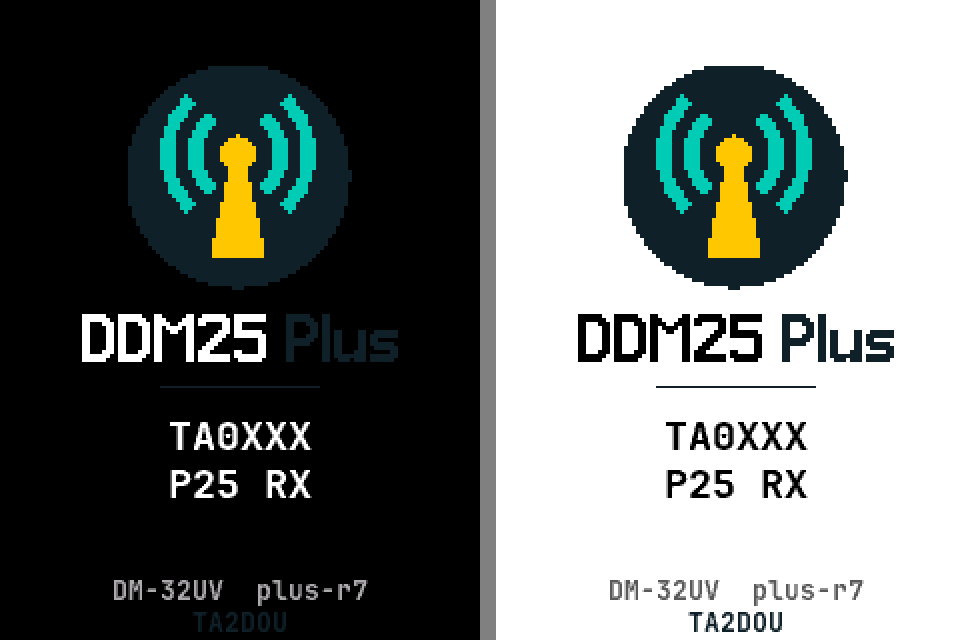
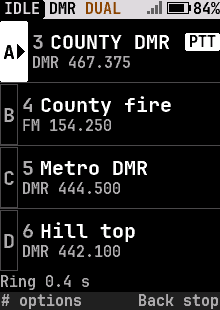
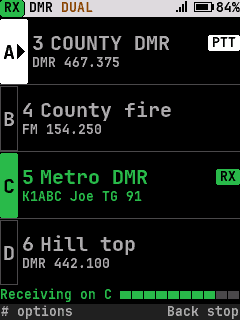
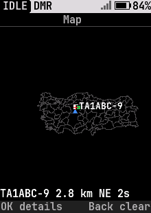
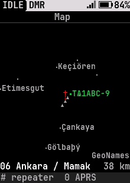
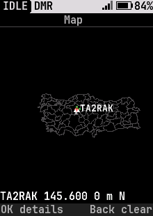
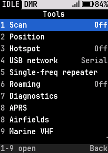
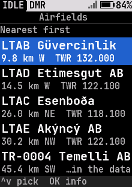
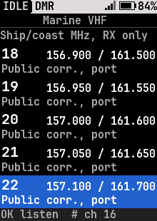
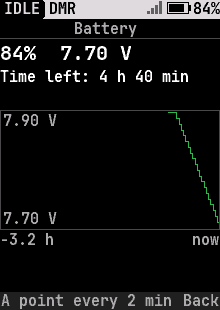

<div align="center">



# DDM32 Plus

**Turkish-first open firmware for the Baofeng DM-32UV — P25, DMR, YSF, NXDN, dPMR, APRS, maps and much more.**

by **d0ukan · TA2DOU**

[](LICENSING.md)
[](https://github.com/tylerwatt12/Open25-DM32)
[](https://github.com/d0ukan/DDM32-Plus/releases/tag/v1.0.0-beta.3)

[Türkçe README](README.tr.md)

</div>

> [!CAUTION]
> ## ⚠️ DISCLAIMER — READ BEFORE USING
>
> DDM32 Plus is **unofficial, experimental** firmware and programming software. It is not affiliated with or
> endorsed by Baofeng, RadioFoundry or Open25-DM32.
>
> - Flashing firmware **can permanently brick your radio**, erase calibration and channel data, and void your warranty.
> - This software is provided **"AS IS", without warranty of any kind**, express or implied, including merchantability
>   or fitness for a particular purpose.
> - **You flash, install and use it entirely at your own risk and responsibility.** The authors (d0ukan / TA2DOU) and
>   contributors accept **no liability for any malfunction, damage, data loss, or direct or indirect loss** to radios,
>   computers or any other equipment.
> - Transmitting is legal **only with a valid licence on authorised frequencies**; complying with radio regulations is
>   solely your responsibility. **Do not rely** on this firmware for emergency or safety-of-life communication.
> - Always make and keep a **full backup** before flashing.
>
> **By downloading, installing or using this software you confirm that you have read, understood and accepted these
> terms. If you do not accept them, do not use it.**

## Status

DDM32 Plus is in **beta**. The latest pre-release is **[v1.0.0-beta.3](https://github.com/d0ukan/DDM32-Plus/releases/tag/v1.0.0-beta.3)** (2026-11-20). It was
installed and checked on the author's radio (boot screen, themes, Home with its frequency, Large text, Marine, map,
multi-watch, the DOTA Transfer screens).
Every feature below is built and covered by host tests (a simulator of the radio's screens, radio core and
modems), but **many features have not yet been tried on the air**. Radio test notes live in
[`docs/plus-radio-test.md`](docs/plus-radio-test.md); changes per release in [CHANGELOG.md](CHANGELOG.md).

## Where it comes from

```
RadioFoundry (MIT)  ──►  Open25-DM32 Classic r13 (MIT)  ──►  DDM32 Plus (GPL-3.0-or-later)
open firmware base        P25, IMBE, native modem, CPS        this fork: everything below
```

DDM32 Plus is an independent fork. It is **not** an official RadioFoundry or Open25-DM32 release. Please report
DDM32 Plus problems [here](https://github.com/d0ukan/DDM32-Plus/issues), not to the upstream projects. The upstream
README is kept in [`docs/UPSTREAM-README.md`](docs/UPSTREAM-README.md).

## Features

### Digital and analogue modes

| Mode | Receive | Transmit | Notes |
| --- | :---: | :---: | --- |
| FM / AM | ✅ | ✅ FM | AM on the air band and (if the receiver allows it) elsewhere; tone finder for CTCSS/DCS |
| DMR Tier I/II | ✅ | ✅ | Any colour code / timeslot / talkgroup, roaming, SMS, emergency, Tier III trunk following (receive) |
| P25 Phase 1 | ✅ | ✅ | NAC in hex **and decimal**, Any NAC/TG, split RX/TX NAC, emergency and unit-to-unit calls, trunk following |
| YSF (C4FM) | ✅ DN + VW | ⚙️ VW (off by default) | callsigns from the header |
| NXDN48 | ✅ | — | |
| dPMR | ✅ | — | |

### Listening

- **Frequency on Home** under the channel (RX/TX for repeaters), and Large text up to twice as big.
- **Multi-watch 2–6 channels**: rows A–F on Home, each letter a channel **or its own VFO** in any mode.
- **Every mode in the VFO**: type a frequency and pick FM / DMR / P25 / YSF / NXDN / dPMR / AM with all parameters,
  including Any.
- **Zone scan with P25** that catches short calls, **priority channel**, **temporary skip**.
- P25 search, DMR search, spectrum and close call, fox hunt.

| Multi-watch | A call on C |
| :---: | :---: |
|  |  |

### Maps and position

- Offline **Turkey map**: 81 provinces, **973 districts**, repeaters, APRS stations heard, your track.
- **Repeaters**: 252 built in (DMR and FM), grouped by province, nearest first, one key tunes the VFO;
  **auto repeater** suggests a nearer one while you travel.
- **APRS** receive and transmit, messages, SOS; GPS, Go-To with waypoints, sun and moon.
- **Satellites**: passes, pass alarm, Doppler-corrected tracking.
- **Airfields** (nearest first, AM tune) and a **marine VHF** table (receive only).

| APRS on the map | Track | Repeater pick |
| :---: | :---: | :---: |
|  |  |  |

### Tools

**DOTA Transfer**: send channels, zones or everything to another DDM32 Plus radio over FM or DMR (beta, not yet
tried between two radios). Tone finder (CTCSS/DCS), DTMF / SelCall decoder, CW decoder and practice, pager (POCSAG) and ACARS, SSTV receive,
CW beacon, lone worker (sound, DMR emergency or APRS SOS), call history with QSO marks, battery graph with time
left, MMDVM hotspot over the programming cable, FM caller ID, signal quality.

| Tools | Airfields | Marine VHF | Battery |
| :---: | :---: | :---: | :---: |
|  |  |  |  |

*Screenshots come from the firmware's own screen simulator (English UI; the radio runs Turkish by default). Photos
from a real radio will follow.*

### Turkish first

The whole interface is translated to Turkish (and remains available in English). Technical names (RX, TX, NAC, VFO,
…) stay as they are.

## Installing

Use the **DDM32 Plus programmer** for Windows (no Python needed):

1. Download `DDM32Plus-1.0.0-beta.2.zip` (the programmer; it lists and installs the newest firmware, v1.0.0-beta.3)
   from the [v1.0.0-beta.2 release](https://github.com/d0ukan/DDM32-Plus/releases/tag/v1.0.0-beta.2) and unzip it.
2. Run `DDM32Plus.exe`. Windows may warn about an unknown publisher (the program is not code-signed yet):
   **More info → Run anyway**.
3. Connect the programming cable (CH340) and follow the steps; the program tells you when to switch the radio off
   and on.

Coming from v1.0.0-beta.1 (published as DDM25 Plus)? That program cannot update itself across the rename:
download the zip above once. Your backups and settings are found and kept.

The programmer backs the radio up,
shows exactly what will change, installs (also from the radio's stock firmware, using the radio's own codec), goes
back to the previous version or to stock from your own backup, checks signed updates and lists every version.
Guide: [`pc/README.en.md`](pc/README.en.md) · source: [`pc/`](pc/). Everything **at your own risk** (see the
disclaimer above).

## In development

- **DOTA Transfer** (Tools, in v1.0.0-beta.3): radio-to-radio transfer of channels, zones or the whole channel set
  (DOTA Clone) over FM (AFSK, with a CTCSS tone) or DMR data, with a pairing code, progress on both radios, and
  nothing changed on the receiver unless everything arrived. Host-tested; two-radio tests pending.
- **New Windows programmer** (C# / .NET, one exe, installer, Turkish / English, self-update, quick update from
  your last backup). Its backup and its install have been checked on a real radio (v1.0.0-beta.3 was installed
  with it).
- Last calls of every mode, several air frequencies at once, a 3D waterfall, APRS station pages, Mic-E, a
  store-and-forward cross-band repeater (attended only).

## Building

The build follows upstream's [`BUILD.md`](BUILD.md) (csky-elf toolchain, pinned sources). DDM32 Plus adds:

```sh
python3 tools/build_radiofoundry.py --plus --stack-check --verify-rebuild           # full DDM32 Plus
python3 tools/build_radiofoundry.py --plus --public --stack-check --verify-rebuild  # public profile (no ID database)
make test
```

Feature notes, RAM budget and design decisions: [`docs/plus.md`](docs/plus.md).

## Licence and credits

- Upstream files (RadioFoundry, Open25-DM32) are **MIT**; DDM32 Plus additions are **GPL-3.0-or-later**; a DDM32
  Plus firmware image is distributed under GPL-3.0-or-later. Details: [`LICENSING.md`](LICENSING.md).
- Third-party code and data, with their terms: [`THIRD_PARTY.md`](THIRD_PARTY.md) — RadioFoundry, Open25-DM32,
  FreeRTOS, DM32-nxdn-p25, MMDVMHost, dsdcc, Natural Earth, GeoNames (CC BY 4.0), OurAirports, RadioID.net, TRAC,
  CelesTrak.
- Many thanks to the RadioFoundry and Open25-DM32 authors, whose work this is built on.
