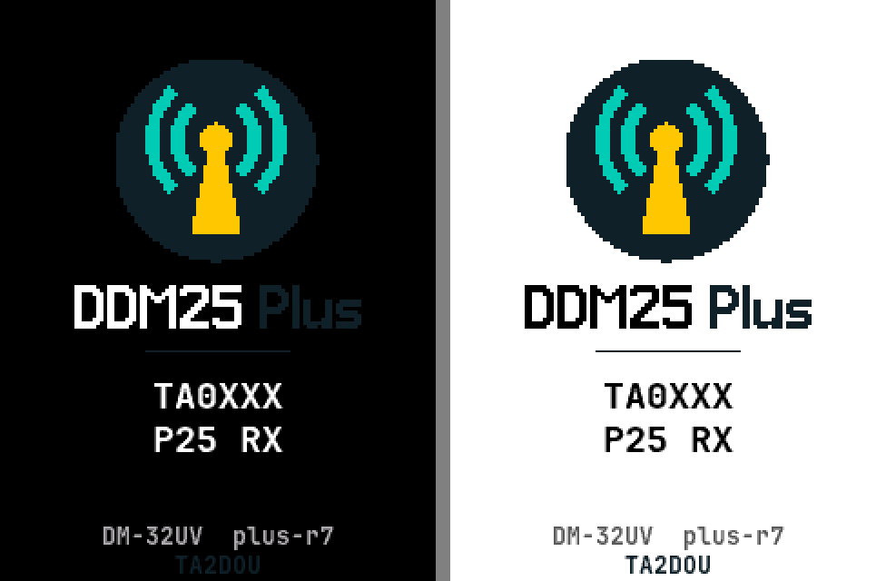
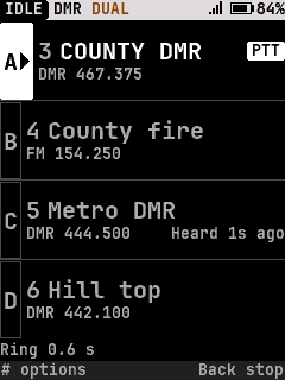
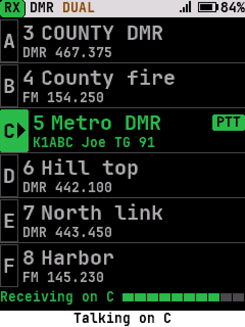
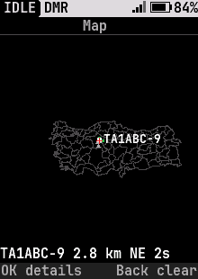
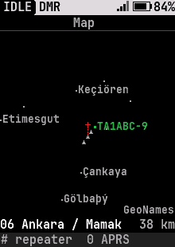
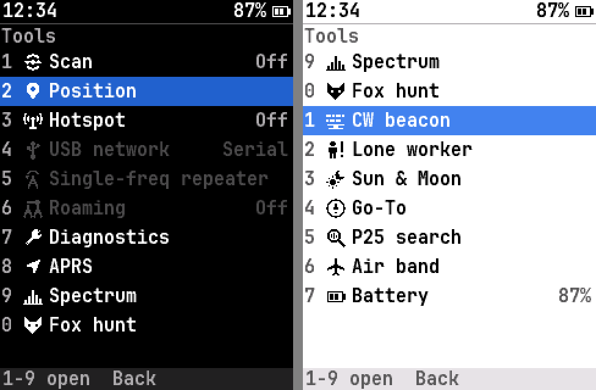
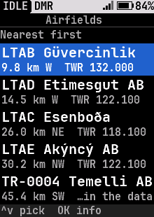
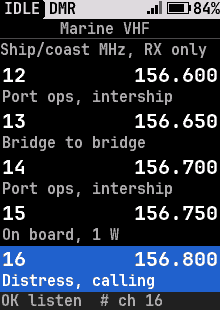
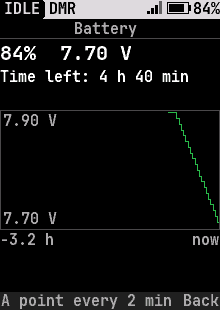

<div align="center">



# DDM25 Plus

**Baofeng DM-32UV için Türkçe öncelikli açık firmware — P25, DMR, YSF, NXDN, dPMR, APRS, harita ve çok daha fazlası.**

**d0ukan · TA2DOU**

[](LICENSING.md)
[](https://github.com/tylerwatt12/Open25-DM32)
[](#durum)

[English README](README.md)

</div>

> [!CAUTION]
> ## ⚠️ SORUMLULUK REDDİ — OKUMADAN KULLANMAYIN
>
> DDM25 Plus **resmî olmayan, deneysel** bir firmware ve programlama aracıdır. Baofeng, RadioFoundry veya Open25-DM32
> ile bağlantılı değildir ve onlar tarafından onaylanmamıştır.
>
> - Telsizinize firmware yüklemek (flashlamak) **telsizinizi kalıcı olarak kullanılamaz hâle getirebilir**,
>   kalibrasyon verilerini, kanal kayıtlarını ve garantinizi kaybettirebilir.
> - Bu yazılım **"OLDUĞU GİBİ"**, hiçbir açık veya örtülü garanti olmaksızın sunulur. Çalışacağı, hatasız olduğu
>   veya belirli bir amaca uygun olduğu garanti **edilmez**.
> - Yükleme, kurulum ve kullanımın **tüm riski ve sorumluluğu size aittir.** Geliştiriciler (d0ukan / TA2DOU) ve
>   katkıda bulunanlar; telsizde, bilgisayarda veya başka ekipmanda oluşabilecek **hiçbir arıza, hasar, veri kaybı,
>   doğrudan veya dolaylı zarardan sorumlu tutulamaz.**
> - Yayın yapmak (TX) yalnızca **geçerli bir lisansla ve izinli frekanslarda** yasaldır. Telsiz mevzuatına uymak
>   tamamen kullanıcının sorumluluğundadır. Acil durum ve can güvenliği haberleşmesi için bu firmware'e
>   **güvenmeyin.**
> - Yüklemeden önce mutlaka **tam yedek** alın ve yedeği güvenli bir yerde saklayın.
>
> **Bu yazılımı indirerek, yükleyerek veya kullanarak bu koşulları okuduğunuzu, anladığınızı ve kabul ettiğinizi
> beyan etmiş olursunuz. Kabul etmiyorsanız kullanmayın.**

## Durum

DDM25 Plus **beta** aşamasındadır. Aşağıdaki her özellik yazıldı ve bilgisayarda testlerden geçti (telsizin ekran,
radyo çekirdeği ve modemlerinin simülatörü), ama **çoğu henüz gerçek bir telsizde denenmedi**. İlk herkese açık
sürüm "ön sürüm" (pre-release) olarak işaretlenecek. Telsiz test notları: [`docs/plus-radio-test.md`](docs/plus-radio-test.md).

## Nereden geliyor

```
RadioFoundry (MIT)  ──►  Open25-DM32 Classic r13 (MIT)  ──►  DDM25 Plus (GPL-3.0-or-later)
açık firmware temeli      P25, IMBE, native modem, CPS        bu fork: aşağıdaki her şey
```

DDM25 Plus bağımsız bir fork'tur; RadioFoundry'nin veya Open25-DM32'nin resmî bir sürümü **değildir**. DDM25 Plus
ile ilgili sorunları upstream projelere değil, [buraya](https://github.com/d0ukan/DDM25-Plus/issues) bildirin.
Upstream'in README'si [`docs/UPSTREAM-README.md`](docs/UPSTREAM-README.md) içinde duruyor.

## Özellikler

### Dijital ve analog modlar

| Mod | Alma | Gönderme | Notlar |
| --- | :---: | :---: | --- |
| FM / AM | ✅ | ✅ FM | AM air band'de ve alıcının izin verdiği diğer frekanslarda; CTCSS/DCS ton bulucu |
| DMR Tier I/II | ✅ | ✅ | Any renk kodu / slot / talkgroup, roaming, SMS, acil çağrı, Tier III trunk takibi (alma) |
| P25 Faz 1 | ✅ | ✅ | NAC hem **hex hem desimal**, Any NAC/TG, ayrı RX/TX NAC, acil ve birebir çağrılar, trunk takibi |
| YSF (C4FM) | ✅ DN + VW | ⚙️ VW (varsayılan kapalı) | başlıktan çağrı işareti |
| NXDN48 | ✅ | — | |
| dPMR | ✅ | — | |

### Dinleme

- **2–6 kanal izleme**: ana ekranda A–F satırları; her harf bir kanal **ya da kendi VFO'su**, her modda.
- **VFO'da her mod**: frekansı yaz, FM / DMR / P25 / YSF / NXDN / dPMR / AM seç, Any dahil tüm ayarlarıyla.
- **P25'li zone tarama** (kısa çağrıları yakalar), **öncelikli kanal**, **geçici atlama**.
- P25 arama, DMR arama, spektrum ve close call, fox hunt.

| Çoklu izleme | C'de bir çağrı |
| :---: | :---: |
|  |  |

### Harita ve konum

- Çevrimdışı **Türkiye haritası**: 81 il, **973 ilçe**, röleler, duyulan APRS istasyonları, yürüdüğünüz iz.
- **Röleler**: 252 hazır röle (DMR ve FM), il il gruplu, en yakın önce, tek tuşla VFO'ya; **otomatik röle**
  yolculukta daha yakın röleyi önerir.
- **APRS** alma ve gönderme, mesaj, SOS; GPS, işaretli noktalarla Go-To, güneş ve ay.
- **Uydular**: geçişler, geçiş alarmı, Doppler düzeltmeli takip.
- **Havalimanları** (en yakın önce, AM ile ayar) ve **deniz VHF** tablosu (sadece alma).

| Haritada APRS | İz | Röle seçimi |
| :---: | :---: | :---: |
|  |  |  |

### Araçlar

Ton bulucu (CTCSS/DCS), DTMF / SelCall çözücü, CW çözücü ve pratik, pager (POCSAG) ve ACARS, SSTV alma, CW beacon,
lone worker (ses, DMR acil veya APRS SOS), QSO işaretli çağrı geçmişi, kalan süreli pil grafiği, programlama kablosu
üzerinden MMDVM hotspot, FM arayan kimliği, sinyal kalitesi.

| Araçlar | Havalimanları | Deniz VHF | Pil |
| :---: | :---: | :---: | :---: |
|  |  |  |  |

*Ekran görüntüleri firmware'in kendi ekran simülatöründen alındı (İngilizce arayüz; telsiz varsayılan olarak
Türkçe). Gerçek telsiz fotoğrafları eklenecek.*

### Önce Türkçe

Arayüzün tamamı Türkçeye çevrildi (İngilizce de seçilebilir). Teknik adlar (RX, TX, NAC, VFO, …) olduğu gibi kalır.

## Kurulum

Windows için **DDM25 Plus programlayıcı**yı kullanın (Python gerekmez): ilk sürüm çıkınca
[Releases](https://github.com/d0ukan/DDM25-Plus/releases) sayfasından indirin. Telsizin yedeğini alır, neyin
değişeceğini tam olarak gösterir, yükler (telsizin kendi codec'iyle stok yazılımdan da), kendi yedeğinizden önceki
sürüme veya stok yazılıma geri döner, imzalı güncellemeleri denetler ve tüm sürümleri listeler.
Rehber: [`pc/README.md`](pc/README.md) · kaynak: [`pc/`](pc/). Her şey **sizin sorumluluğunuzdadır** (yukarıdaki
sorumluluk reddine bakın).

## Derleme

Derleme upstream'in [`BUILD.md`](BUILD.md) dosyasını izler (csky-elf araç zinciri, sabitlenmiş kaynaklar).
DDM25 Plus şunları ekler:

```sh
python3 tools/build_radiofoundry.py --plus --stack-check --verify-rebuild           # tam DDM25 Plus
python3 tools/build_radiofoundry.py --plus --public --stack-check --verify-rebuild  # herkese açık profil (ID veritabanı yok)
make test
```

Özellik notları, RAM bütçesi ve tasarım kararları: [`docs/plus.md`](docs/plus.md).

## Lisans ve teşekkür

- Upstream dosyaları (RadioFoundry, Open25-DM32) **MIT**; DDM25 Plus eklemeleri **GPL-3.0-or-later**; bir DDM25 Plus
  firmware imajı GPL-3.0-or-later altında dağıtılır. Ayrıntılar: [`LICENSING.md`](LICENSING.md).
- Üçüncü taraf kod ve veriler, koşullarıyla: [`THIRD_PARTY.md`](THIRD_PARTY.md) — RadioFoundry, Open25-DM32,
  FreeRTOS, DM32-nxdn-p25, MMDVMHost, dsdcc, Natural Earth, GeoNames (CC BY 4.0), OurAirports, RadioID.net, TRAC,
  CelesTrak.
- Bu çalışmanın üzerine kurulduğu RadioFoundry ve Open25-DM32 geliştiricilerine çok teşekkürler.
