<div align="center">


# DDM32 Plus

**Baofeng DM-32UV için Türkçe öncelikli açık firmware — P25, DMR, YSF, NXDN, dPMR, APRS, harita ve çok daha fazlası.**

**d0ukan · TA2DOU**

[](LICENSING.md)
[](https://github.com/tylerwatt12/Open25-DM32)
[](https://github.com/d0ukan/DDM32-Plus/releases/tag/v1.0.0-beta.4)

[English README](README.md)

</div>

> [!CAUTION]
> ## ⚠️ SORUMLULUK REDDİ — OKUMADAN KULLANMAYIN
>
> DDM32 Plus **resmî olmayan, deneysel** bir firmware ve programlama aracıdır. Baofeng, RadioFoundry veya Open25-DM32
> ile bağlantılı değildir ve onlar tarafından onaylanmamıştır.
>
> - Telsizinize firmware yüklemek (flashlamak) **telsizinizi kalıcı olarak kullanılamaz hâle getirebilir**,
>   kalibrasyon verilerini, kanal kayıtlarını ve garantinizi kaybettirebilir.
> - Bu yazılım **"OLDUĞU GİBİ"**, hiçbir açık veya örtülü garanti olmaksızın sunulur. Çalışacağı, hatasız olduğu
>   veya belirli bir amaca uygun olduğu garanti **edilmez**.
> - Yükleme, kurulum ve kullanımın **tüm riski ve sorumluluğu size aittir.** Geliştiriciler (d0ukan / TA2DOU) ve
>   katkıda bulunanlar; telsizde, bilgisayarda veya başka ekipmanda oluşabilecek **hiçbir arıza, hasar, veri kaybı,
>   doğrudan veya dolaylı zarardan sorumlu tutulamaz.**
> - Yayın yapmak (TX) yalnızca **geçerli bir lisansla ve izinli frekanslarda** yasaldır. Telsiz mevzuatına uymak
>   tamamen kullanıcının sorumluluğundadır. Acil durum ve can güvenliği haberleşmesi için bu firmware'e
>   **güvenmeyin.**
> - Yüklemeden önce mutlaka **tam yedek** alın ve yedeği güvenli bir yerde saklayın.
>
> **Bu yazılımı indirerek, yükleyerek veya kullanarak bu koşulları okuduğunuzu, anladığınızı ve kabul ettiğinizi
> beyan etmiş olursunuz. Kabul etmiyorsanız kullanmayın.**

## Durum

DDM32 Plus **beta** aşamasındadır. En son ön sürüm **[v1.0.0-beta.4](https://github.com/d0ukan/DDM32-Plus/releases/tag/v1.0.0-beta.4)** (2026-11-21), yeni Windows programı
2.0.0-beta.1 ile birlikte. İkisi de yazarın telsizinde denendi (beta.3 ve beta.4 yeni programla kuruldu).
Aşağıdaki her özellik yazıldı ve bilgisayarda testlerden geçti (telsizin ekran, radyo çekirdeği ve modemlerinin
simülatörü), ama **birçok özellik henüz havada denenmedi**. Telsiz test notları:
[`docs/plus-radio-test.md`](docs/plus-radio-test.md); sürüm değişiklikleri: [CHANGELOG.md](CHANGELOG.md).

## Nereden geliyor

```
RadioFoundry (MIT)  ──►  Open25-DM32 Classic r13 (MIT)  ──►  DDM32 Plus (GPL-3.0-or-later)
açık firmware temeli      P25, IMBE, native modem, CPS        bu fork: aşağıdaki her şey
```

DDM32 Plus bağımsız bir fork'tur; RadioFoundry'nin veya Open25-DM32'nin resmî bir sürümü **değildir**. DDM32 Plus
ile ilgili sorunları upstream projelere değil, [buraya](https://github.com/d0ukan/DDM32-Plus/issues) bildirin.
Upstream'in README'si [`docs/UPSTREAM-README.md`](docs/UPSTREAM-README.md) içinde duruyor.

## Özellikler

### Dijital ve analog modlar

| Mod | Alma | Gönderme | Notlar |
| --- | :---: | :---: | --- |
| FM / AM | ✅ | ✅ FM | AM air band'de ve alıcının izin verdiği diğer frekanslarda; CTCSS/DCS ton bulucu |
| DMR Tier I/II | ✅ | ✅ | Any renk kodu / slot / talkgroup, roaming, SMS, acil çağrı, Tier III trunk takibi (alma) |
| P25 Faz 1 | ✅ | ✅ | NAC hem **hex hem desimal**, Any NAC/TG, ayrı RX/TX NAC, acil ve birebir çağrılar, trunk takibi |
| YSF (C4FM) | ✅ DN + VW | ⚙️ VW (varsayılan kapalı) | başlıktan çağrı işareti |
| NXDN48 | ✅ | — | |
| dPMR | ✅ | — | |

### Dinleme

- **Ana ekranda frekans**: kanalın altında (rölelerde RX/TX), Large text iki kata kadar büyük.
- **2–6 kanal izleme**: ana ekranda A–F satırları; her harf bir kanal **ya da kendi VFO'su**, her modda.
- **VFO'da her mod**: frekansı yaz, FM / DMR / P25 / YSF / NXDN / dPMR / AM seç, Any dahil tüm ayarlarıyla.
- **P25'li zone tarama** (kısa çağrıları yakalar), **öncelikli kanal**, **geçici atlama**.
- P25 arama, DMR arama, spektrum ve close call, fox hunt.

| Çoklu izleme | C'de bir çağrı |
| :---: | :---: |
| 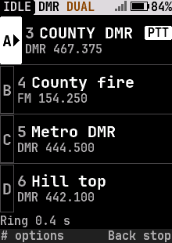 | 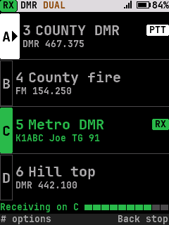 |

### Harita ve konum

- Çevrimdışı **Türkiye haritası**: 81 il, **973 ilçe**, röleler, duyulan APRS istasyonları, yürüdüğünüz iz.
- **Röleler**: 252 hazır röle (DMR ve FM), il il gruplu, en yakın önce, tek tuşla VFO'ya; **otomatik röle**
  yolculukta daha yakın röleyi önerir.
- **APRS** alma ve gönderme, mesaj, SOS; GPS, işaretli noktalarla Go-To, güneş ve ay.
- **Uydular**: geçişler, geçiş alarmı, Doppler düzeltmeli takip.
- **Havalimanları** (en yakın önce, AM ile ayar) ve **deniz VHF** tablosu (sadece alma).

| Haritada APRS | İz | Röle seçimi |
| :---: | :---: | :---: |
| 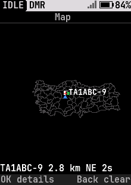 |  | 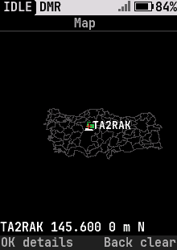 |

### Araçlar

**DOTA Transfer**: kanalları, bölgeleri, tümünü ya da bir veri paketini başka bir DDM32 Plus telsize FM veya DMR ile
gönderir (beta, henüz iki telsiz arasında denenmedi). Tüm modlarda ve izlenen kanallarda **son çağrılar**, **çapraz
bant kaydet-ilet** (DMR, yalnızca başındayken), **hava bandı izleme** (bir meydanın frekansları birlikte), **3D
şelale**, **Mic-E** beacon, Go-To ve haritayla **APRS istasyon sayfası**, **veri paketleri** (RadioID isimleri, hava
bandı frekansları), kendi aralık ve adımınızla daha hızlı P25 / DMR arama, **kanal silme**. Ton bulucu (CTCSS/DCS), DTMF / SelCall çözücü, CW çözücü ve pratik, pager (POCSAG) ve ACARS, SSTV alma, CW beacon,
lone worker (ses, DMR acil veya APRS SOS), QSO işaretli çağrı geçmişi, kalan süreli pil grafiği, programlama kablosu
üzerinden MMDVM hotspot, FM arayan kimliği, sinyal kalitesi.

| Araçlar | Havalimanları | Deniz VHF | Pil |
| :---: | :---: | :---: | :---: |
| 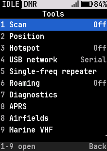 |  | 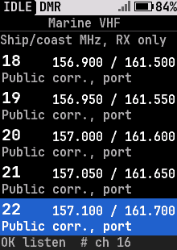 |  |

| Son çağrılar | APRS istasyonu | Hakkında: veri paketleri | DOTA frekansı |
| :---: | :---: | :---: | :---: |
| 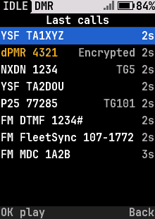 | 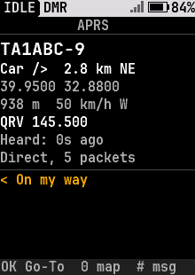 | 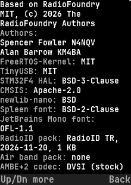 | 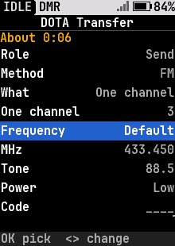 |

| Arama aralığı | Kanal silme | Desimal NAC |
| :---: | :---: | :---: |
| 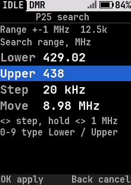 | 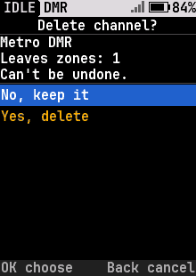 | 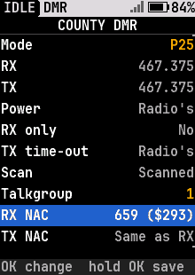 |

*Ekran görüntüleri firmware'in kendi ekran simülatöründen alındı (İngilizce arayüz; telsiz varsayılan olarak
Türkçe). Gerçek telsiz fotoğrafları eklenecek.*

### Önce Türkçe

Arayüzün tamamı Türkçeye çevrildi (İngilizce de seçilebilir). Teknik adlar (RX, TX, NAC, VFO, …) olduğu gibi kalır.

Telsizde kullanım için kısa Türkçe kılavuz (tuşlar, bölge ve kanallar, çoklu izleme, modlar, arama, harita /
APRS / havalimanları, DOTA, veri paketleri, çapraz bant, tanılama): [`docs/kullanim-telsiz.md`](docs/kullanim-telsiz.md).

## Kurulum

Windows 10/11 için **DDM32 Plus programlayıcı**yı kullanın (başka hiçbir şey kurmanız gerekmez):

1. [Son sürümden](https://github.com/d0ukan/DDM32-Plus/releases/tag/v1.0.0-beta.4) `DDM32Plus-Setup-2.0.0-beta.1.exe` dosyasını indirip çalıştırın. Yalnızca sizin
   kullanıcınıza kurulur (yönetici izni istemez), Başlat menüsü ve masaüstü kısayolu oluşturur. Windows "bilinmeyen
   yayıncı" uyarısı verebilir (program henüz kod imzalı değil): **Ek bilgi → Yine de çalıştır**.
2. İlk açılışta **Türkçe** ya da **English** seçin.
3. Programlama kablosunu (CH340) takın, **Telsizi güncelle** sekmesine geçip adımları izleyin; telsizi ne zaman
   kapatıp açacağınızı program söyler. Yedekleriniz programın `yedekler` klasöründe durur; güncellemede ve
   kaldırmada da silinmez.

Programlayıcı telsizin yedeğini alır (ya da aynı telsizin son yedeğini kullanır), neyin değişeceğini tam olarak
gösterir, yükler (telsizin kendi codec'iyle stok yazılımdan da), kendi yedeğinizden önceki sürüme veya stok yazılıma
geri döner, imzalı güncellemeleri denetler, kendini günceller ve kendi indirdiğiniz dosyalardan bilgisayarınızda
oluşturduğu **veri paketlerini** (RadioID isimleri, hava bandı frekansları) telsize yükler. Rehber:
[`win/docs/kullanim.md`](win/docs/kullanim.md). Her şey **sizin sorumluluğunuzdadır** (yukarıdaki sorumluluk reddine
bakın).

Eski Python programı (`DDM32Plus-1.0.0-beta.2.zip`, [`pc/`](pc/)) çalışmaya devam eder; `%LOCALAPPDATA%\DDM32Plus`
(ya da `DDM25Plus`) içindeki yedekleri yeni program da bulur.

## Geliştirilmekte olanlar

- DOTA Transfer'in (kanallar ve veri paketleri) ve DMR çapraz bant kaydet-ilet'in iki telsizle denenmesi.
- DMR alım sesi: tanılama v1.0.0-beta.4'te (Araçlar > Tanılama); ses seviyesi inceleniyor.
- İl il havalimanları, renkli 3D spektrum ve şelale.

## Derleme

Derleme upstream'in [`BUILD.md`](BUILD.md) dosyasını izler (csky-elf araç zinciri, sabitlenmiş kaynaklar).
DDM32 Plus şunları ekler:

```sh
python3 tools/build_radiofoundry.py --plus --stack-check --verify-rebuild           # tam DDM32 Plus
python3 tools/build_radiofoundry.py --plus --public --stack-check --verify-rebuild  # herkese açık profil (ID veritabanı yok)
make test
```

Özellik notları, RAM bütçesi ve tasarım kararları: [`docs/plus.md`](docs/plus.md).

## Lisans ve teşekkür

- Upstream dosyaları (RadioFoundry, Open25-DM32) **MIT**; DDM32 Plus eklemeleri **GPL-3.0-or-later**; bir DDM32 Plus
  firmware imajı GPL-3.0-or-later altında dağıtılır. Ayrıntılar: [`LICENSING.md`](LICENSING.md).
- Üçüncü taraf kod ve veriler, koşullarıyla: [`THIRD_PARTY.md`](THIRD_PARTY.md) — RadioFoundry, Open25-DM32,
  FreeRTOS, DM32-nxdn-p25, MMDVMHost, dsdcc, Natural Earth, GeoNames (CC BY 4.0), OurAirports, RadioID.net, TRAC,
  CelesTrak.
- Bu çalışmanın üzerine kurulduğu RadioFoundry ve Open25-DM32 geliştiricilerine çok teşekkürler.
